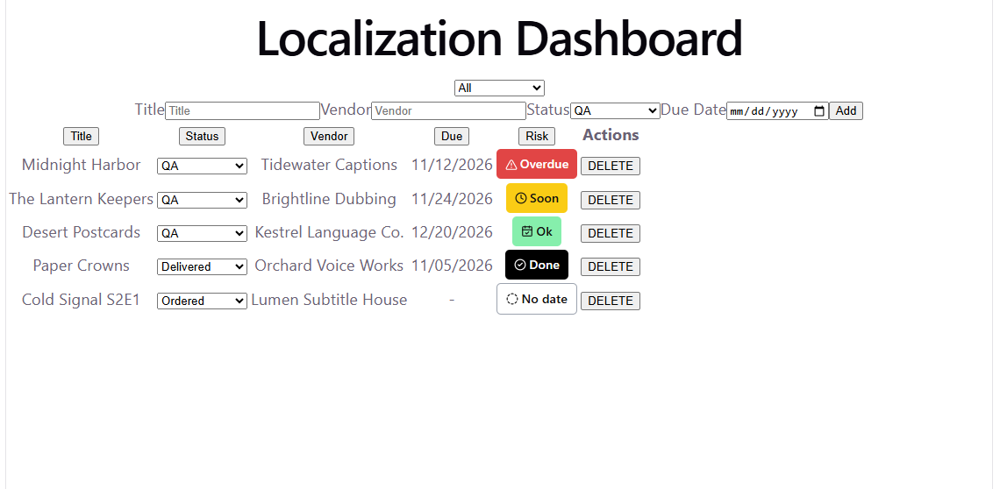

# Localization Dashboard

A dashboard for tracking localization content sent to vendors, sorted by due-date urgency.

## Live demo
- https://localization-ops-dashboard.vercel.app/
- https://localization-ops-dashboard.onrender.com/api/items

## Tech stack
- JavaScript
- TypeScript
- Node.js
- React
- Express
- Prisma
- Postgres
- Vercel
- Render
- Neon
- GitHub

## Features
- Sorting: Sorts by title, status, vendor, due date, and risk in ascending or descending order when clicked
- Status filtering: The dropdown filters the table to show items with one status like "QA" or "Delivered"
- Risk Levels: overdue = past due, soon = due within 14 days, ok = due in more than 14 days, done = project is delivered, none = no date has been set
- Unit tests: Tests several dates to verify if the expected urgency matches the due date expectations
- CI: GitHub Actions runs the type check and unit test on every push
- Risk badges that use an icon and text label, not just color, and respects the reduced-motion setting
- API input validation (422 with a clear message)

## Run it locally
- In /localization-dashboard  run `npm install` and then `npm run dev` followed by `npm test`
- In /localization-api run `npm install` and then `node server.js`
- You will also need to create an .env file in the /localization-api folder with your own "DATABASE_URL" value.
- Dashboard talks to http://localhost:3000 by default and uses VITE_API to point at another API